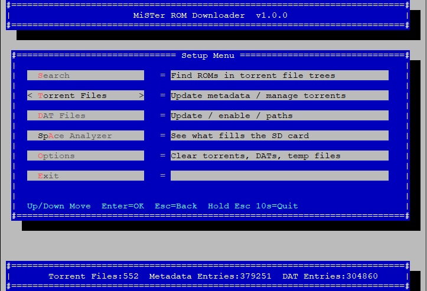
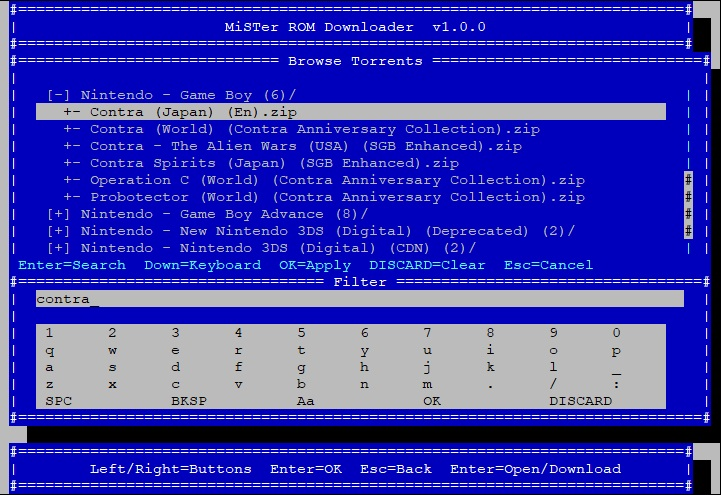
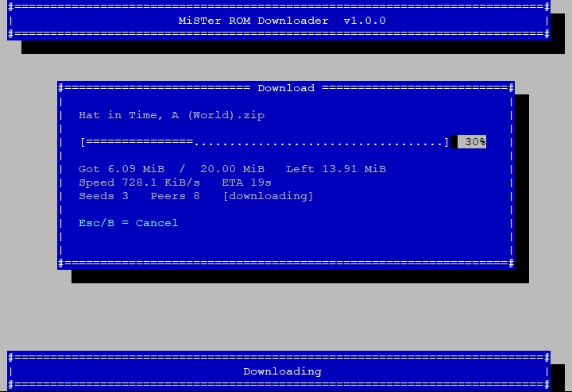
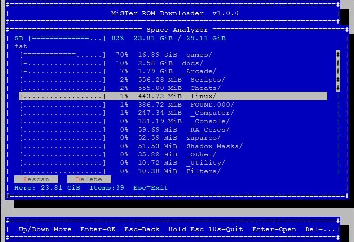

# MiSTer ROM downloader

<p>
  <a href="assets/1.jpg"></a>
  <a href="assets/2.jpg"></a>
  <a href="assets/3.jpg"></a>
  <a href="assets/4.jpg"></a>
</p>

MiSTer script: drop magnet / `.torrent` files → searchable ROM list → download into `/games` (DAT or manual mapping). Download-only (no seeding).

Version: see `Scripts/.config/mister_rom_downloader/VERSION`

## Install

Copy `Scripts/` to the SD root (`/media/fat/`):

```
/media/fat/Scripts/MiSTer_ROM_downloader.sh
/media/fat/Scripts/.config/mister_rom_downloader/
```

Menu: **Scripts → MiSTer_ROM_downloader** (same `MiSTer_*` naming style as other scripts).

## First run

1. Put your own `*.magnet` / `*.torrent` files into `magnets/` (see that folder’s README).
2. **Torrent Files → Update metadata** to fetch torrent file lists.
3. Optionally **DAT Files → Update** (defaults point at [MiSTer Organize](https://github.com/MiSTerOrganize/MiSTer_Organize) DatRoot).
4. **Search** to find and download into `/media/fat/games`.

Bundled `bin/aria2c` is a static armv7 build for MiSTer (see `bin/README.md`).

## Layout

```
Scripts/
  MiSTer_ROM_downloader.sh          # launcher
  .config/mister_rom_downloader/
    VERSION
    mister_rom_downloader.sh
    lib/                            # TUI + logic
    bin/aria2c
    fonts/
    config.env
    aria2.conf
    dat_sources.defaults.conf       # shipped DAT source list
    magnets/                        # you add magnets/torrents here
    meta/                           # local metadata cache
    catalog/                        # local search index
    dats/                           # local DAT cache
    inbox/  selection/              # runtime
```

## Support

If the tool helps you, donations are welcome:

- [DonatePay](https://donatepay.ru/don/neewb20221)


## License / content

This project ships **code and tooling only**. You are responsible for the legality of any torrents, magnets, and ROM files you add or download.
